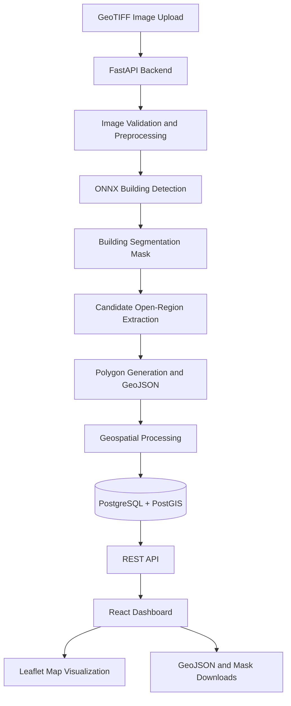

# 🛰️ AI-Based Automated Urban Parcel Mapping

### AI-Powered Building Detection and Candidate Open-Region Extraction from Georeferenced Aerial Imagery

An intelligent geospatial mapping system that uses computer vision, deep learning and GIS technologies to analyze satellite and drone imagery, detect buildings, and extract potential open regions for urban parcel mapping.

---

## 📌 1. Project Overview

Urban planning and land-use analysis require accurate information about buildings, vacant spaces and spatial boundaries. Traditional mapping approaches often involve extensive manual inspection and processing of aerial imagery.

This project aims to automate parts of this workflow using Artificial Intelligence and geospatial processing.

The system accepts georeferenced aerial imagery in GeoTIFF format, performs AI-based building detection, identifies candidate open regions, generates geospatial polygons and visualizes the results through an interactive web-based GIS dashboard.

The platform combines deep learning, image processing and geospatial technologies to make aerial image analysis more efficient and accessible.

## 🎯 2. Objectives

- Automate building detection from satellite and drone imagery.
- Identify potential open regions between detected buildings.
- Extract candidate spatial regions and generate polygon boundaries.
- Preserve geographic coordinates throughout image processing.
- Calculate candidate-region areas.
- Visualize detected buildings and open regions on an interactive map.
- Store processing history and results for future reference.
- Provide downloadable geospatial outputs for further analysis.

## 💡 3. Proposed Solution

The system follows an end-to-end geospatial processing workflow.

1. **Image Input:** Users upload georeferenced GeoTIFF imagery.
2. **Preprocessing:** The input imagery is validated and prepared for AI inference.
3. **Building Detection:** An ONNX-based segmentation model processes image tiles and generates a building mask.
4. **Candidate Region Extraction:** Image-processing and geospatial algorithms identify potential open regions.
5. **Polygon Generation:** Candidate regions are converted into geospatial polygons.
6. **Geospatial Processing:** Coordinate reference systems and geographic boundaries are preserved.
7. **Database Storage:** Processing runs, metadata and spatial results are stored using PostgreSQL and PostGIS.
8. **Visualization:** Results are displayed through an interactive React and Leaflet dashboard.

## 🏗️ 4. System Architecture



## 🛠️ 5. Technology Stack

| Component | Technologies |
|---|---|
| Programming Language | Python, JavaScript |
| AI / Deep Learning | ONNX Runtime |
| Image Processing | OpenCV, NumPy |
| Geospatial Processing | Rasterio, Shapely, PyProj |
| Backend | FastAPI, Uvicorn |
| Frontend | React.js, Vite |
| Map Visualization | Leaflet, React-Leaflet |
| Database | PostgreSQL |
| Spatial Database Extension | PostGIS |
| Data Exchange | GeoJSON |
| Containerization | Docker, Docker Compose |
| Version Control | Git, GitHub |

## ✨ 6. Key Features

### AI-Based Building Detection
- Uses an ONNX segmentation model for automated building detection.
- Processes large aerial images through tiled inference.
- Generates building segmentation masks.
- Tracks processing progress.

### Candidate Open-Region Extraction
- Identifies potential open regions using image-processing techniques.
- Generates candidate-region masks.
- Converts extracted regions into polygon geometries.
- Calculates approximate candidate-region areas.

### Geospatial Processing
- Supports georeferenced GeoTIFF imagery.
- Uses Rasterio for raster processing.
- Uses Shapely for geometric operations.
- Uses PyProj for coordinate transformations.
- Generates geospatial overlays for map visualization.

### Interactive GIS Dashboard
The React-based dashboard provides:

- GeoTIFF upload.
- Project and processing-run history.
- Building detection visualization.
- Candidate open-region visualization.
- Polygon boundary visualization.
- Processing status and progress.
- GeoJSON export.
- Building-mask and candidate-mask downloads.

### Spatial Database Integration
- PostgreSQL for persistent data storage.
- PostGIS for spatial geometry storage and operations.
- Processing-run history and project metadata management.

## 🗺️ 7. Map Visualization Layers

The interactive Leaflet map provides four visualization layers.

| Layer | Description |
|---|---|
| Image | Original aerial imagery preview |
| Buildings | AI-generated building detection overlay |
| Open Regions | Extracted candidate open-region overlay |
| Polygons | Polygon boundaries of candidate regions |

Users can enable or disable individual layers to inspect the results independently.

## 📊 8. Sample Processing Results

The following results were obtained using the sample dataset `residential_blocks.tif`.

| Parameter | Result |
|---|---|
| Input Image | residential_blocks.tif |
| Image Dimensions | 4342 × 7055 pixels |
| Number of Bands | 3 |
| Coordinate Reference System | EPSG:4326 |
| Building Pixels Detected | 5,062,655 |
| Candidate Regions Extracted | 568 |
| Total Candidate Region Area | 58,722 m² |
| Processing Status | Completed |

*These are results from one sample processing run. Results may vary depending on image quality, geographical characteristics and input resolution.*

## 📁 9. Project Structure

```text
AI-URBAN-PARCEL-MAPPING/
│
├── ai_model/
│   ├── model_weights/
│   └── building_detection.py
│
├── backend/
│   ├── routes/
│   │   ├── uploads.py
│   │   ├── processing.py
│   │   └── runs.py
│   ├── services/
│   │   ├── pipeline.py
│   │   └── overlays.py
│   └── main.py
│
├── database/
│   ├── db.py
│   └── schema.sql
│
├── dataset/
│   └── raw_images/
│
├── frontend/
│   ├── app.py
│   └── web/
│       ├── src/
│       │   ├── App.jsx
│       │   ├── MapView.jsx
│       │   ├── api.js
│       │   ├── main.jsx
│       │   └── styles.css
│       ├── package.json
│       └── vite.config.js
│
├── parcel_extraction/
│   └── extract_parcels.py
│
├── preprocessing/
│   ├── image_loader.py
│   ├── display.py
│   └── preview.py
│
├── tests/
│
├── docker-compose.yml
├── requirements.txt
├── README.md
└── IMPLEMENTATION_STATUS.md
```

## ⚙️ 10. Installation and Setup

### Prerequisites

Install the following:

- Python 3.10 or compatible version supported by the dependencies.
- Node.js and npm.
- Docker Desktop.
- Git.

### Step 1: Clone the Repository

```bash
git clone https://github.com/Yashaswini-Nanjundaiah/AI-URBAN-PARCEL-MAPPING.git

cd AI-URBAN-PARCEL-MAPPING
```

### Step 2: Create a Python Virtual Environment

```bash
python -m venv .venv
```

Activate it on Windows:

```bash
.venv\Scripts\activate
```

### Step 3: Install Python Dependencies

```bash
pip install -r requirements.txt
```

### Step 4: Add the AI Model

The ONNX model weights are not included in the repository.

Place the required model file at:

```text
ai_model/model_weights/model.onnx
```

### Step 5: Add Input Imagery

Place a suitable georeferenced GeoTIFF image in:

```text
dataset/raw_images/
```

Alternatively, upload a GeoTIFF through the dashboard.

### Step 6: Start PostgreSQL and PostGIS

Make sure Docker Desktop is running.

Execute:

```bash
docker compose up -d
```

This starts the PostgreSQL/PostGIS database service defined in `docker-compose.yml`.

### Step 7: Start the Backend

From the project root:

```bash
uvicorn backend.main:app --reload
```

Backend API:

```text
http://localhost:8000
```

Interactive API documentation:

```text
http://localhost:8000/docs
```

### Step 8: Start the Frontend

Open another terminal:

```bash
cd frontend/web
```

Install frontend dependencies:

```bash
npm install
```

Start the development server:

```bash
npm run dev
```

Open the dashboard using the local URL displayed by Vite, typically:

```text
http://localhost:5173
```

## 📤 11. Output and Export

The system generates the following outputs:

| Output | Description |
|---|---|
| Building Mask | Raster representation of detected buildings |
| Candidate Region Mask | Raster representation of extracted open regions |
| GeoJSON | Geospatial polygon representation of candidate regions |
| Building Overlay | Georeferenced building visualization |
| Candidate Overlay | Georeferenced candidate-region visualization |

GeoJSON outputs can be used in compatible GIS software for further spatial analysis.

## 🔬 12. Future Improvements

Potential future enhancements include:

- Improving building detection accuracy across different geographical environments.
- Incorporating additional land-cover classification techniques.
- Distinguishing roads, vegetation and other land-cover categories from usable open spaces.
- Improving candidate-region boundary extraction.
- Adding confidence scores for detected buildings and candidate regions.
- Supporting additional raster formats and coordinate reference systems.
- Optimizing inference for large-scale aerial imagery.
- Integrating additional GIS analysis capabilities.
- Improving dashboard filtering, reporting and visualization.
- Validating extracted candidate regions against authoritative cadastral datasets.

## ⚠️ 13. Limitations

- Detection quality depends on the resolution and quality of input imagery.
- AI predictions may contain false positives and false negatives.
- Candidate open regions are algorithmically extracted and may include roads, vegetation or other land-cover types.
- Extracted polygons are candidate regions, not legally verified cadastral parcel boundaries.
- Results require further validation before being used for official land administration or legal purposes.
- The pretrained ONNX model weights and large input datasets are not distributed with this repository.

## 🤝 14. Contributing

Contributions and improvements are welcome!

Team members can contribute to:

- AI model development and evaluation.
- Building detection and segmentation.
- Geospatial algorithms and polygon extraction.
- Backend API development.
- Database and spatial-query optimization.
- Frontend and map visualization.
- Testing and documentation.

### Contribution Workflow

1. Fork or clone the repository.
2. Create a separate feature branch.
3. Implement and test your changes.
4. Commit your changes with meaningful messages.
5. Submit a pull request for review.

## 📜 15. Project Information

**Project:** AI-Based Automated Urban Parcel Mapping

**Domain:** Artificial Intelligence, Computer Vision and Geospatial Technology

**Application:** Automated analysis of satellite and drone imagery for building detection and candidate open-region extraction.

**Repository:** [AI-URBAN-PARCEL-MAPPING](https://github.com/Yashaswini-Nanjundaiah/AI-URBAN-PARCEL-MAPPING)

---

